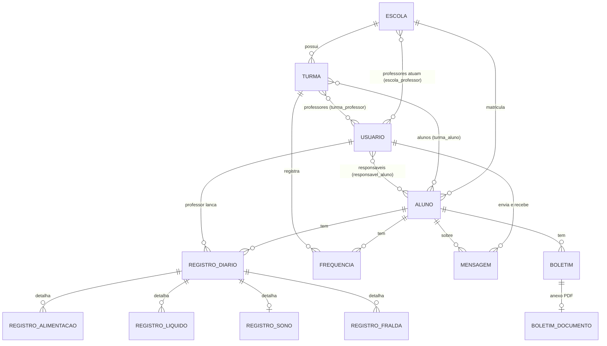

# LumiKids

**Sistema web de gestão e acompanhamento diário de alunos da Educação Infantil.**

O LumiKids substitui a agenda de papel das escolas infantis. O professor registra o dia de cada criança (alimentação, líquidos, sono, troca de fralda e observações) e a presença. O responsável acompanha tudo pelo navegador, vê relatórios e baixa documentos. A administração gerencia escolas, turmas, alunos e usuários.

> Projeto desenvolvido como Trabalho de Conclusão de Curso (TCC) do curso Superior de Tecnologia em Análise e Desenvolvimento de Sistemas, Instituto Federal Farroupilha – Campus São Vicente do Sul (IFFar-SVS).

## Sumário

1. [Funcionalidades](#funcionalidades)
2. [Tecnologias](#tecnologias)
3. [Requisitos](#requisitos)
4. [Instalação](#instalação)
5. [Configuração do .env](#configuração-do-env)
6. [Primeiro acesso: ordem recomendada de cadastro](#primeiro-acesso-ordem-recomendada-de-cadastro)
7. [Como usar, por perfil](#como-usar-por-perfil)
8. [Regras do sistema que vale conhecer](#regras-do-sistema-que-vale-conhecer)
9. [Rotas principais](#rotas-principais)
10. [Banco de dados](#banco-de-dados)
11. [Estrutura do projeto](#estrutura-do-projeto)
12. [Segurança e privacidade](#segurança-e-privacidade)
13. [Problemas comuns](#problemas-comuns)
14. [Publicação em servidor](#publicação-em-servidor)
15. [Limitações e próximos passos](#limitações-e-próximos-passos)
16. [Autor e licença](#autor-e-licença)

---

## Funcionalidades

O sistema tem **três perfis de acesso**, cada um com o seu menu e o seu painel inicial.

| Perfil | O que faz |
|---|---|
| **Administrador** | Cadastra escolas, turmas, alunos e usuários. Aprova ou recusa cadastros novos e vincula o aluno ao responsável. Registra e edita qualquer registro diário e frequência. Envia comunicados por e-mail. Gera relatórios por turma, aluno e período. |
| **Professor** | Vê as turmas dele. Lança o registro diário dos alunos e a frequência. Envia comunicados por e-mail aos responsáveis dos alunos das turmas dele. Escreve boletins. Edita apenas os registros que ele mesmo lançou. |
| **Responsável** | Acompanha o dia a dia dos filhos (registros com detalhe do dia) e a frequência, com filtro por filho e por período. Vê o relatório do filho com calendário de presença e baixa em PDF. Consulta os comunicados da escola e os boletins. |

Outras funcionalidades:

- **Cadastro com aprovação:** quem se cadastra pela tela pública fica "pendente" até o administrador aprovar.
- **Recuperação de senha** por e-mail, com link de validade limitada.
- **Multi-escola:** o sistema atende várias escolas. Um professor pode atuar em mais de uma escola, e um responsável pode ter filhos em escolas diferentes.
- **Histórico preservado:** ao excluir um usuário ou aluno, o histórico (registros, frequência, mensagens) continua guardado (exclusão lógica).
- **Boletim:** texto escrito pelo professor ou administrador, com PDF opcional anexado (até 10 MB).
- **Relatórios em PDF** do aluno, para o administrador e para o responsável.
- **Layout responsivo**, com painel de marca no topo das telas de login e cadastro no celular.

## Tecnologias

| Camada | Tecnologia |
|---|---|
| Linguagem / framework | PHP + **Laravel 13** (arquitetura MVC, Blade, Eloquent ORM, migrations) |
| Banco de dados | **MySQL** (ou MariaDB) |
| Front-end | HTML, CSS, JavaScript, **Bootstrap 5** e **Bootstrap Icons** (via CDN), fontes Poppins e Inter (Google Fonts) |
| PDF | `barryvdh/laravel-dompdf` (Dompdf) |
| E-mail | Laravel Mail (SMTP) |
| Traduções | `laravel-lang/lang` (mensagens em pt-BR) |
| Ambiente de desenvolvimento | Laragon, VS Code, Git/GitHub, DBeaver |

O front-end usa arquivos estáticos em `public/css` e `public/js` e o Bootstrap vem por CDN. **Não é necessário rodar `npm`** para usar o sistema.

## Requisitos

- **PHP 8.3 ou superior** (a versão mínima exata está no `composer.json`; o projeto foi desenvolvido com PHP 8.5)
- Extensões PHP: `ctype`, `curl`, `dom`, `fileinfo`, `gd`, `mbstring`, `openssl`, `pdo_mysql`, `tokenizer`, `xml`, `zip`
- **Composer** 2
- **MySQL 8** ou MariaDB 10.4+
- **Git**
- Opcional (recomendado no Windows): **Laragon**, que já traz PHP, MySQL, Composer e Git

## Instalação

Os passos abaixo funcionam em qualquer sistema. As observações para o Laragon (Windows) aparecem junto.

### 1. Baixar o projeto

```bash
git clone https://github.com/Henric-ops/TCC.git lumikids
cd lumikids
```

> No Laragon, clone dentro de `C:\laragon\www`. Com os "Auto virtual hosts" ativos, o projeto abre em `http://nome-da-pasta.test`.

### 2. Instalar as dependências

```bash
composer install
```

### 3. Criar o arquivo de configuração

```bash
# Linux / macOS / Git Bash
cp .env.example .env

# Windows (cmd)
copy .env.example .env

php artisan key:generate
```

### 4. Criar o banco de dados

No DBeaver, no phpMyAdmin ou pelo terminal do MySQL:

```sql
CREATE DATABASE bdtcc CHARACTER SET utf8mb4 COLLATE utf8mb4_unicode_ci;
```

O nome pode ser outro. Basta usar o mesmo nome em `DB_DATABASE` no `.env`.

### 5. Ajustar o `.env`

Abra o `.env` e preencha ao menos a parte do banco. O restante está em [Configuração do .env](#configuração-do-env).

### 6. Criar as tabelas

```bash
php artisan migrate
```

### 7. Liberar o acesso às fotos dos alunos

```bash
php artisan storage:link
```

> No Windows, este comando pode exigir um terminal aberto **como Administrador**. Sem ele, as fotos dos alunos aparecem quebradas.

### 8. Ajustar o fuso horário

Várias telas usam "hoje" como padrão (registros, frequência, dashboards). Em `config/app.php`, confira se o fuso é o do Brasil:

```php
'timezone' => 'America/Sao_Paulo',
```

Com o padrão `UTC`, depois das 21h "hoje" passa a ser o dia seguinte.

### 9. Criar a primeira escola e o administrador

O perfil de administrador **não é criado pela tela de cadastro**, por segurança. Crie o primeiro pelo terminal:

```bash
php artisan tinker
```

```php
$escola = App\Models\Escola::create([
    'nome' => 'Escola Exemplo',
    'cnpj' => '00.000.000/0001-00',
    'endereco' => 'Rua Exemplo, 123',
    'telefone' => '(55) 0000-0000',
    'email' => 'contato@escola-exemplo.com',
]);

App\Models\User::create([
    'escola_id' => $escola->id,
    'nome' => 'Administrador',
    'email' => 'admin@exemplo.com',
    'senha' => 'troque-esta-senha',
    'perfil' => 'admin',
    'status' => 'aprovado',
]);
```

A senha é criptografada automaticamente ao salvar. **Troque o e-mail e a senha do exemplo.** Digite `exit` para sair do tinker.

### 10. Iniciar o sistema

```bash
php artisan serve
```

Abra **http://127.0.0.1:8000** e entre com o administrador criado.

## Configuração do .env

| Variável | Para que serve | Exemplo |
|---|---|---|
| `APP_NAME` | Nome exibido no sistema | `LumiKids` |
| `APP_ENV` | Ambiente | `local` (desenvolvimento) ou `production` |
| `APP_DEBUG` | Mostra erros detalhados. **Use `false` em produção** | `true` |
| `APP_URL` | Endereço do sistema (usado nos links dos e-mails) | `http://127.0.0.1:8000` |
| `APP_LOCALE` | Idioma das mensagens | `pt_BR` |
| `DB_HOST` / `DB_PORT` | Servidor do banco | `127.0.0.1` / `3306` |
| `DB_DATABASE` | Nome do banco | `bdtcc` |
| `DB_USERNAME` / `DB_PASSWORD` | Acesso ao banco (no Laragon: `root` e senha vazia) | `root` / |
| `MAIL_MAILER` | Como enviar e-mails | `log` (teste) ou `smtp` (real) |
| `MAIL_FROM_ADDRESS` / `MAIL_FROM_NAME` | Remetente dos e-mails | `nao-responda@escola.com` |

Exemplo de trecho do `.env` para desenvolvimento:

```ini
APP_NAME=LumiKids
APP_ENV=local
APP_DEBUG=true
APP_URL=http://127.0.0.1:8000
APP_LOCALE=pt_BR
APP_FALLBACK_LOCALE=pt_BR

DB_CONNECTION=mysql
DB_HOST=127.0.0.1
DB_PORT=3306
DB_DATABASE=bdtcc
DB_USERNAME=root
DB_PASSWORD=

MAIL_MAILER=log
MAIL_FROM_ADDRESS="nao-responda@lumikids.local"
MAIL_FROM_NAME="${APP_NAME}"
```

### E-mail: teste e envio de verdade

**Para testar sem enviar nada:** deixe `MAIL_MAILER=log`. Os e-mails (comunicados e recuperação de senha) são gravados em `storage/logs/laravel.log`.

**Para enviar de verdade (exemplo com Gmail):** ative a verificação em duas etapas na conta, gere uma "senha de app" e use:

```ini
MAIL_MAILER=smtp
MAIL_HOST=smtp.gmail.com
MAIL_PORT=587
MAIL_USERNAME=seu-email@gmail.com
MAIL_PASSWORD=sua-senha-de-app
MAIL_ENCRYPTION=tls
MAIL_FROM_ADDRESS=seu-email@gmail.com
MAIL_FROM_NAME="${APP_NAME}"
```

Depois de alterar o `.env`, rode `php artisan config:clear`.

## Primeiro acesso: ordem recomendada de cadastro

Há dependências entre os cadastros. Siga esta ordem na primeira vez:

1. **Entrar como administrador** (criado no passo 9).
2. **Escolas:** cadastre as escolas do sistema.
3. **Professores:** em *Usuários*, crie o professor e marque em quais escolas ele atua. (Outra opção: o professor se cadastra pela tela pública e o administrador aprova.)
4. **Turmas:** em *Turmas*, escolha a escola. Só aparecem para seleção os professores que atuam nela.
5. **Alunos:** em *Alunos*, informe a escola, a foto (opcional) e as turmas.
6. **Responsáveis:** o responsável se cadastra pela tela pública. Em *Usuários*, o administrador clica em **Verificar**, escolhe o(s) aluno(s) e o parentesco e **aprova**. (Também dá para o administrador criar o responsável já vinculado.)
7. Pronto: o professor já pode lançar registros e frequência, e o responsável já enxerga o filho.

## Como usar, por perfil

### Administrador

| Menu | O que fazer |
|---|---|
| **Dashboard** | Resumo do dia (frequências batidas, registros feitos), cadastros pendentes de aprovação e atividade recente. |
| **Escolas** | Cadastrar, editar e excluir escolas. A exclusão é bloqueada se houver usuários, alunos ou turmas vinculados. |
| **Turmas** | Criar a turma e definir os professores responsáveis. |
| **Alunos** | Cadastrar o aluno com foto e turmas. A exclusão é lógica (o histórico é mantido). |
| **Usuários** | Criar professores e responsáveis, editar, excluir e **verificar cadastros pendentes** (aprovar ou recusar). |
| **Registros Diários** e **Frequência** | Lançar e corrigir qualquer registro, em qualquer turma. |
| **Comunicados** | Enviar e-mail a um responsável (escolhe o aluno e depois o responsável). |
| **Relatórios** | Escolher a turma (resumo de todos os alunos) ou também um aluno (relatório individual), com período De/Até. O relatório individual pode ser baixado em PDF. |

### Professor

1. **Cadastro:** *Criar conta* na tela de login, escolhendo o perfil Professor. Aguarde a aprovação do administrador.
2. **Dashboard:** mostra as turmas dele, quantos registros foram feitos hoje e quais turmas ainda estão sem frequência.
3. **Minhas Turmas:** lista as turmas e os alunos de cada uma.
4. **Registros Diários > Novo registro:** escolha a **turma**, depois o **aluno**, e preencha:
   - **Alimentação** (colação, almoço, lanche, jantar) e **Líquidos** (leite, suco, água): *Tudo*, *Parte* ou *Rejeitou*.
   - **Sono:** dormiu sim ou não e até dois períodos, com duração calculada automaticamente.
   - **Troca de fralda:** contadores de xixi e cocô, mais observações.
5. **Frequência:** escolha a turma e a data, marque *Presente* ou *Falta* (com justificativa opcional) e salve. Reabrir a mesma turma e data permite corrigir. O histórico tem filtros por turma, aluno e data.
6. **Comunicados:** escolha o aluno e o responsável, escreva o assunto e a mensagem. O responsável recebe por e-mail.
7. **Boletim:** escreva o texto e, se já tiver o documento pronto, anexe o PDF.

### Responsável

1. **Cadastro:** *Criar conta*, escolhendo o perfil Responsável. Aguarde o administrador aprovar e vincular você ao seu filho.
2. **Dashboard:** um card por filho com a frequência de hoje e se o registro do dia já foi feito, mais os comunicados recentes (clique para ler).
3. **Registros:** por padrão mostra só **hoje**. Use os filtros De/Até para ver outros dias. *Ver detalhes* abre a alimentação, o sono e as trocas de fralda do dia.
4. **Frequência:** mesmo comportamento, com a justificativa das faltas.
5. **Relatório:** escolha o filho e o período. Mostra presença, registros, média de sono e o **calendário de presença**. O botão *Baixar PDF* gera o arquivo.
6. **Boletins e comunicados:** consulte os boletins e os comunicados enviados pela escola.

## Regras do sistema que vale conhecer

- **Cadastro público = pendente.** A pessoa só consegue entrar depois de aprovada. Contas pendentes ou recusadas veem uma mensagem ao tentar o login.
- **Professor edita só o que lançou.** O administrador edita qualquer registro. Registros de outro professor aparecem sem botão de editar.
- **O registro diário é sempre do dia atual.** Para consultar outros dias, use os filtros da listagem. Ao editar, a data original é mantida.
- **Fralda por contador.** Cada unidade contada vira uma troca registrada, com o horário do momento em que o formulário foi salvo.
- **Listagens abrem em "hoje".** Registros e frequência mostram o dia atual até você escolher um período.
- **Escola consistente.** Professor só entra em turma de escola em que atua. O aluno só entra em turma da própria escola.
- **Exclusão lógica.** Usuários e alunos excluídos somem das telas de cadastro e o usuário excluído não consegue mais entrar. Registros, frequência e mensagens antigas continuam consultáveis, com o nome correto.
- **Comunicação por e-mail, em mão única.** Professor ou administrador envia ao responsável. O professor só alcança responsáveis dos alunos das turmas dele. O envio fica registrado no sistema.

## Rotas principais

| Perfil | Caminho | Tela |
|---|---|---|
| Todos | `/login`, `/register`, `/esqueci-senha` | Acesso, cadastro e recuperação de senha |
| Todos | `/dashboard` | Redireciona para o painel do perfil |
| Admin | `/admin/escolas`, `/admin/usuarios`, `/admin/turmas`, `/admin/alunos` | Cadastros |
| Admin | `/admin/relatorios` | Relatórios por turma, aluno e período |
| Admin e Professor | `/registros-diarios`, `/frequencia`, `/frequencia/historico`, `/emails` | Registro diário, frequência e comunicados |
| Professor | `/minhas-turmas` | Turmas do professor |
| Responsável | `/meus-registros`, `/minha-frequencia`, `/meu-relatorio` | Acompanhamento do filho |

Para listar todas as rotas: `php artisan route:list`.

## Banco de dados

Principais tabelas:

| Tabela | Conteúdo |
|---|---|
| `escolas` | Instituições |
| `usuarios` | Administradores, professores e responsáveis (`perfil`, `status`, exclusão lógica) |
| `escola_professor` | Escolas em que cada professor atua (N:N) |
| `alunos` | Crianças (foto, exclusão lógica) |
| `turmas` | Turmas por escola |
| `turma_professor`, `turma_aluno`, `responsavel_aluno` | Vínculos (professor–turma, aluno–turma, responsável–aluno com parentesco) |
| `registro_diarios` | O registro do dia de um aluno |
| `registro_alimentacaos`, `registro_liquidos`, `registro_sonos`, `registro_fraldas` | Detalhes do registro diário |
| `frequencias` | Presença ou falta por aluno, turma e data |
| `mensagens` | Histórico dos comunicados enviados por e-mail |
| `boletins`, `boletim_documentos` | Boletins e o PDF anexado |
| `password_reset_tokens` | Tokens de recuperação de senha (do framework) |

Relacionamentos:



## Estrutura do projeto

```
app/
├── Http/
│   ├── Controllers/
│   │   ├── Admin/                 # Escola, Usuario, Turma, Aluno (cadastros do administrador)
│   │   ├── DashboardController.php
│   │   ├── LoginController.php, RegisterController.php, PasswordResetController.php
│   │   ├── RegistroDiarioController.php
│   │   ├── FrequenciaController.php
│   │   ├── EmailController.php    # comunicados por e-mail
│   │   ├── RelatorioController.php
│   │   ├── TurmaController.php    # "Minhas Turmas" do professor
│   │   └── ComunicadoController.php
│   ├── Middleware/EnsurePerfil.php   # restringe rotas por perfil (alias `perfil`)
│   └── Requests/                  # validação dos formulários
├── Mail/EmailResponsavel.php      # e-mail enviado ao responsável
└── Models/                        # User, Escola, Aluno, Turma, RegistroDiario, Frequencia, Mensagem...
database/migrations/               # estrutura do banco
public/
├── css/                           # estilos de cada tela
├── js/
└── img/                           # logos e imagens
resources/views/                   # telas em Blade (auth, dashboard, usuarios, turmas, alunos, registros, frequencia, relatorios...)
routes/web.php                     # todas as rotas
```

## Segurança e privacidade

O sistema guarda dados de crianças, então algumas medidas foram adotadas:

- Senhas **criptografadas** (hash) e proteção **CSRF** em todos os formulários.
- **Controle de acesso por perfil** nas rotas e conferência de permissão em cada registro (professor só vê as turmas dele, responsável só vê os filhos dele).
- **Aprovação manual** de cadastros novos.
- **Validação cruzada de escola** no cadastro de turmas, alunos e vínculos.
- **Exclusão lógica**, preservando o histórico.
- O **PDF do boletim** fica guardado no banco e só é entregue a usuários autorizados, sem link público.
- Link de recuperação de senha com **validade limitada**.

> A preservação do histórico de pessoas excluídas precisa estar de acordo com a LGPD (por exemplo, com política de retenção ou anonimização). Isso está listado em [próximos passos](#limitações-e-próximos-passos).

## Problemas comuns

| Sintoma | Causa provável | Solução |
|---|---|---|
| Foto do aluno aparece quebrada | Falta o link do storage | `php artisan storage:link` (como Administrador no Windows) |
| Mensagens de erro em inglês | Idioma não configurado | `composer require laravel-lang/lang`, `php artisan lang:add pt_BR` e `APP_LOCALE=pt_BR` no `.env` |
| `Table '...' doesn't exist` | Migrations não rodaram | `php artisan migrate` |
| `Route [...] not defined` ou classe não encontrada | Cache antigo | `php artisan optimize:clear` e `composer dump-autoload` |
| E-mail não chega | `MAIL_MAILER=log` (só grava no log) ou SMTP errado | Veja `storage/logs/laravel.log` ou configure o SMTP e rode `php artisan config:clear` |
| Erro 403 ao abrir uma tela | O perfil logado não tem permissão para aquilo | Entre com o perfil correto ou use o administrador |
| Não consigo entrar logo depois de me cadastrar | A conta está pendente | O administrador precisa aprovar em *Usuários > Verificar* |
| Erro ao anexar PDF grande | Limites do PHP ou do MySQL | `upload_max_filesize` ≥ 10M e `post_max_size` ≥ 12M no `php.ini`. No MySQL, `max_allowed_packet` ≥ 32M |
| Datas de "hoje" erradas à noite | Fuso horário em UTC | Defina `'timezone' => 'America/Sao_Paulo'` em `config/app.php` |

Comandos úteis:

```bash
php artisan optimize:clear     # limpa caches de config, rotas e views
php artisan route:list         # lista as rotas
php artisan migrate:fresh      # CUIDADO: apaga todas as tabelas e recria do zero
```

## Publicação em servidor

O sistema foi desenvolvido e validado em ambiente local (Laragon). Para colocar em um servidor, um roteiro resumido:

1. Aponte o servidor web (Apache/Nginx) para a pasta `public/`, nunca para a raiz do projeto.
2. No `.env`: `APP_ENV=production`, `APP_DEBUG=false`, `APP_URL` com o endereço real, banco e SMTP reais.
3. Rode `composer install --no-dev --optimize-autoloader`, `php artisan migrate --force` e `php artisan storage:link`.
4. Gere os caches: `php artisan config:cache`, `php artisan route:cache` e `php artisan view:cache`.
5. Garanta permissão de escrita em `storage/` e `bootstrap/cache/`.
6. Use **HTTPS**.

## Limitações e próximos passos

Ainda não implementado:

- Chat ou resposta do responsável (a comunicação é só da escola para a família, por e-mail).
- Notificações automáticas de novos registros.
- Fotos das atividades do dia.
- Exportação de dados e backup pela interface.
- PDF do relatório de turma (hoje só em tela).
- Calendário letivo (para diferenciar "sem aula" de "faltou").
- Política de retenção e anonimização de dados (LGPD).
- Testes automatizados.

## Autor e licença

- **Autor:** Henric Baccin Sander ([@Henric-ops](https://github.com/Henric-ops))
- **Orientador:** Prof. Me. Gustavo Rissetti
- **Instituição:** Instituto Federal Farroupilha – Campus São Vicente do Sul (IFFar-SVS), RS
- **Ano:** 2026

Projeto acadêmico (TCC). Direitos autorais reservados ao autor. O uso de partes ou do todo deste trabalho deve citar a fonte.
